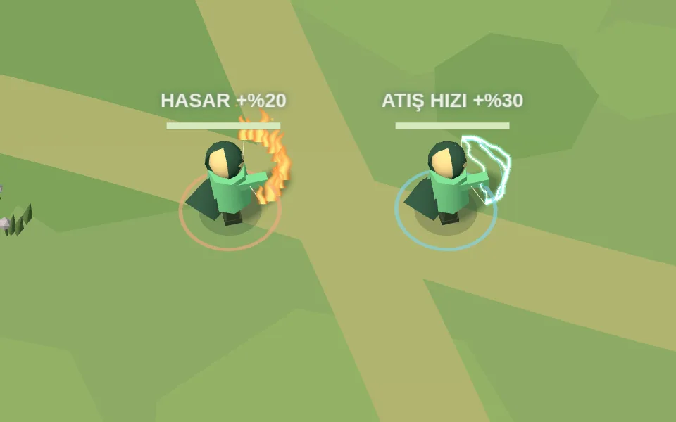

# Yay üzerindeki süreli buff efektleri

Hasar buff'ında (%20 / 15 sn) yay boyunca dalgalanan turuncu-sarı alevler ve yükselen közler görünür. Atış hızı buff'ında (%30 / 15 sn) yay ve kiriş üzerinde mavi-beyaz elektrik arkları hareket eder. Buff değerleri, hasar, ok fiziği ve ağ protokolü değişmez.

Efektler mevcut sunucu verisindeki `buffType` / `buffTime` ile açılıp kapanır; karakter ölünce veya görünmez olunca çizilmez. Hareket, dönüş ve nişan sırasında yay matrisini takip eder. Bütün oyuncular için iki ortak instanced çizim kullanılır; kare veya buff başına geometry, texture ya da ışık oluşturulmaz. Mevcut buff halkaları da renkleri ve nefes alma animasyonu korunarak tek çizimde birleştirilir.

Aşağıdaki yakın çekim, oyunun gerçek Three.js modelleri ve efektlerinden kaydedilmiştir. Yalnızca önizleme kamerası yakınlaştırılmıştır; oyundaki kamera değişmemiştir.

[Durağan görüntü](../public/previews/bow-buffs.png)

Kontroller: GPU shader derlemesi; dönüşte yaya bağlı kalma; süre bitimi, ölüm ve gizlenme; sabit GPU kaynak kullanımı; normal telefon görünümünde gerçek buff toplama; 16 buff'lı oyuncu ile mevcut grafik kalite ve çizim bütçeleri.
