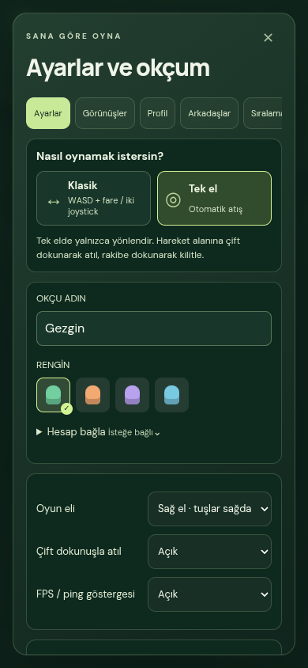

# FPS, ping ve kesintili ok hareketi — 24 Ekim 2026

Kaynak yedeği: [`backup/pre-live-diagnostics-3d07703`](https://github.com/artemis34/orman-arrow-archer/tree/backup/pre-live-diagnostics-3d07703). Değişiklikler önce `fix/live-frame-network-diagnostics` dalında hazırlanır. Otoriter fizik, hasar, çarpışma, 30 Hz simülasyon ve v2 mesaj biçimi değiştirilmez.

## Gösterge nerede?

Ana menü → **⚙ Ayarlar → Ayarlar → FPS / ping göstergesi → Açık**. Tercih cihazda saklanır. Varsayılan kapalıdır; açıkken haritanın altında görünür, dokunmayı engellemez ve büyütülmüş haritanın altına kayar.

- FPS, son üç saniyede gerçekten çizilen kare aralıklarından hesaplanır; 100 ms simülasyon `dt` sınırından hesaplanmaz. p95 kare aralığı ve 50 ms üzerindeki aralık sayısı da görünür. Sekme gizlenince veya oyuna yeniden girince eski örnekler sıfırlanır.
- Ping gerçek WebSocket/Socket.IO gidiş-dönüş ölçümüdür; ilk yanıt gelene kadar “ölçülüyor” yazar. Ölçülmemiş ping artık 0 ms gösterilmez. İlk yoklama hemen, devamı üç saniyede bir yapılır; aynı anda tek yoklama bulunur ve eski ölçüm işaretlenir.
- Veri yaşı, son durumun bu tarayıcıya ulaşmasından beri geçen süredir; tek yönlü ağ gecikmesi değildir. Veri/sn ve jitter durum geliş düzenini, akış oranı alınan simülasyon zamanının yerel süreye oranını gösterir. Tarayıcıdaki bekleme ping ve geliş ölçümlerini de etkileyebilir.
- Antrenmanda ping yerine “YEREL · Sunucu bağlantısı yok” görünür. Gösterge ek HTTP sorgusu veya saniyede bir sunucu durum yoklaması yapmaz; mevcut durum akışını kullanır.

## Bulunan sorunlar ve düzeltmeler

1. **Sınırsız ön plan çizimi:** 120/144 Hz ekran her RAF'ta tam gölge/harita çiziyordu. Fazı koruyan 60 Hz oyun, 30 Hz menü çizim düzeni eklendi. Düşük FPS'de gelen kareler atılmaz; kaçırılmış çizimler birikerek sonradan çalıştırılmaz. Girdi ve ağ gönderimi bağımsız 30 Hz saatinde kalır. Yüksek yenileme testinde 10 saniyede 600 oyun çizimi üretilir. Grafik çözünürlüğü, gölge çözünürlüğü ve efekt sayısı azaltılmaz. Bunun fiziksel cihazdaki ısınma kazanımı henüz ölçülmedi.
2. **Saatin alınan verinin önüne geçmesi:** Uzun süre yavaşlayan otorite saati ve büyük paket boşlukları eski sabit görüntü saatini tüketiyordu. Sadece görüntü saati, alınan simülasyon zamanından hızı öğrenir. Normal 15 Hz akışta ok/uzak oyuncu gecikmeleri 100/125 ms olarak kalır. Ölçülmüş büyük düzensizlikte tampon en fazla 250 ms olur; ek görüntü gecikmesi karşılığında dur–kalk azaltılır. Uzun bağlantı kesintisinde sonsuz ekstrapolasyon yapılmaz; bilinen isabet/ölüm/ok silinmesi hemen geçerlidir. Aynı güvenli ekstrapolasyon mesafe/siper sınırları korunur.
3. **Tekrarlanan statik köşe verisi:** Harita birleştirilirken mevcut indisler atılıp köşeler çoğaltılıyordu. İndisler, yüz sırası ve tam pozisyon/normal/renk değerleri korunur; yaklaşık kaynak birleştirme yapılmaz. Test sahnesinde statik tamponlar indisler dahil 1.672.992 → 1.340.160 bayt (%19,9), saklanan köşeler 69.708 → 51.631; 23.236 üçgen ve çizim çağrıları aynı. Telefon/masaüstü altışar kamera konumunda hem sahne hem gölge haritası pikselleri birebir aynı çıktı.
4. **Boş havuz yüklemeleri:** Kristal, nadir kristal halkası ve güçlendirme tamponları için de sadece etkin bölüm yüklenir; sıfır öğe yükleme üretmez. Bekleyen renk kuyruklarının korunması mevcut yardımcıyla sürer.

## İlk canlı ölçüm

Değişiklikler yayımlanmadan, eski `index-D84ad80y.js` istemcisiyle gerçek Cloudflare adresinde 45 saniyelik test. Bir insan + yedi bot bulunan özel arena; ayrıca ayrı odada, çizim motoru bulunmayan Node WebSocket ölçümü. [Ham rapor](../benchmarks/results/live-diagnostics-2026-10-24/cloudflare-before.json).

| Ölçüm                                        |               Sonuç |
| -------------------------------------------- | ------------------: |
| Çizimden bağımsız gerçek ağ RTT medyan / p95 |    11,28 / 15,10 ms |
| Gelen durum hızı                             |            15,16/sn |
| Alınan simülasyon / geçen süre               |              1,010× |
| Çıkarılan gerçek simülasyon hızı             |            30,31 Hz |
| Durum aralığı p95 / en uzun                  |   70,22 / 101,39 ms |
| 150 ms üzeri durum boşluğu                   |                   0 |
| Yazılımsal GPU çizim FPS / p95 kare aralığı  | 5,32 FPS / 320,7 ms |

Bu ölçüm aralığında sunucu saatinde yavaşlama görülmedi. FPS, başsız Chromium'un **SwiftShader yazılımsal GPU** sonucudur; fiziksel iPhone sonucu değildir. RTT de test makinesinin Cloudflare rotasıdır; Türkiye'deki oyuncunun rotasını veya tüm odaların konumunu kanıtlamaz. Kullanıcının cihazında FPS/ping göstergesiyle ayrıca ölçüm gerekir. Telefon sıcaklığına erişilmedi; ısınmanın düzeldiği iddia edilmez.

## Tekrarlanabilir ok testi

[Ham karşılaştırma](../benchmarks/results/live-diagnostics-2026-10-24/network-clock-comparison.json). Otoriteyi değiştirmeyen deterministik görüntü testi: sekiz saniye, 60 Hz çizim, ilk saniyeden sonraki örnekler. Bunlar canlı sunucu kapasitesi veya cihaz FPS ölçümü değildir.

| Durum                                   | Donan ok kareleri: önce → sonra | Donan uzak oyuncu kareleri: önce → sonra |
| --------------------------------------- | ------------------------------: | ---------------------------------------: |
| Normal 15 Hz / 70 ms düzensizlik        |                         %0 → %0 |                                  %0 → %0 |
| Düzenli 14 Hz                           |                         %0 → %0 |                                  %0 → %0 |
| Düzenli 12,5 Hz, sabit simülasyon adımı |                     %70,64 → %0 |                              %79,00 → %0 |
| Tekrarlanan 200 ms paket boşlukları     |                     %12,17 → %0 |                           %29,12 → %0,72 |

İki dakikalık oturum/tur değişimleri, düşük çizim hızı, yavaş saatten normale dönüş, yetenek koruması ve bilinen çarpışmada okun kaldırılması da sınanır. Tarihsel otorite, JSON, v2 baytları ve istemci görüntü izlerinin referansları değiştirilmeden korunur.

## Doğrulama

Yerelde 314 birim testi, TypeScript kontrolü, her iki build, yeni göstergenin tercih/yerleşim/sekme testleri, gerçek gecikmeli çift dokunma kontrolleri ve ok çizimi geçti. Chrome'daki 12 kamera karşılaştırmasında indisli geometri ile önceki genişletilmiş biçimin sahne ve gölge pikselleri birebir aynı. Tarihsel otorite, JSON, v2 ve istemci izleri referansları değiştirilmeden geçti. Chrome/Safari motorlarının kapsamlı doğrulamaları ayrıca yayın CI'ında çalışır.

`npm run bench:runtime -- --base=... --seconds=45` gerçek çizilen kareleri, ekranda gösterilen sayısal ölçümleri ve ayrı WebSocket akışını raporlar. `Measure live FPS and network` iş akışı üretim sürümüyle eşleşen derlemeyi bekler; sonuç JSON'unu açık **Wildbow runtime measurements** bildiriminde ve `runtime-measurements` dosya ekinde yayımlar. Bu sonuçlar ölçüm yapılmayan cihazlar için FPS garantisi değildir.

Aynı yerel makinedeki 30 saniyelik tek örneklerde, dondurulmuş eski sürüm 6,79 FPS / p95 260,8 ms, yeni sürüm gösterge açıkken 7,47 FPS / p95 169,9 ms verdi. Bağımsız çizim sayacı ile göstergenin medyan 7,50 FPS değeri uyumlu. Yerel Workerd ve SwiftShader aynı CPU'yu paylaştığından bu ortamda sunucu saati de yavaşlayabiliyor; sonuç gerçek Cloudflare kapasitesi değildir. Sahnedeki bot davranışları ve işletim sistemi yükü değişir; bu iki kısa tek örnek istatistiksel FPS kazanımı veya fiziksel iPhone iyileşmesi kanıtı olarak kullanılmaz.
