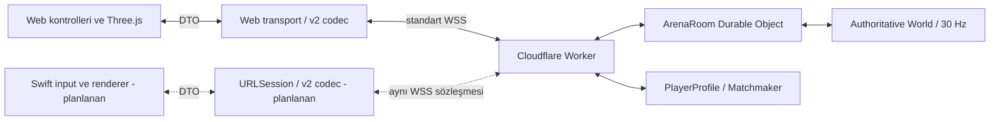

# Wildbow: güvenli optimizasyon ve web/Swift uyumluluğu

Tarih: 21 Ekim 2026. Dal: `optimization/platform-safe-2026-10-21`.
Başlangıç ve korunacak canlı sürüm: `7397e49`.

Çalışma ayrı GitHub dalındadır. `main` birleştirmesi, üretim deploy'u, hosting
değişikliği veya Cloudflare plan değişikliği yapılmadı. Fizik, hasar, çarpışma,
oyun kuralları, sunucu giriş işleme, gönderim saatleri ve protokol sürümü
değiştirilmedi. Üç uygulama değişikliği yalnızca `shared/protocol.js` ve
`client/transport.js` dosyalarındadır. Grafikler ve oyuncu/bot sayıları korunur.

## Mevcut sistemde ne çalışıyor?

| Yol / katman | Gerçek uygulama ve sorumluluk |
| --- | --- |
| Canlı online oyun | Worker HTTP/WSS yönlendirmesi; her odada `ArenaRoom` Durable Object; **standart WebSocket** |
| Otorite | `shared/world.js`: hareket, dash, ok üretimi/uçuşu, çarpışma, hasar, XP, beceri ve botlar; 30 Hz |
| Cloudflare yayını | Oyuncuya özel görünürlük filtresi + v2 delta; 15 durum/sn/oyuncu |
| Node geliştirme/sunucu yolu | Express + Socket.IO; aynı `World`; 30 Hz simülasyon ve **30 Hz tam JSON durumları** |
| Tarayıcı online sunumu | Three.js; yerel hareket tahmini ve reconciliation; uzak oyuncu/ok interpolasyonu; render ekran hızında |
| Antrenman | Aynı `World` tarayıcı içinde çalışır; online sunucuya hasar/konum yazmaz |
| Eşleştirme / profil | Ayrı `ArenaMatchmaker` / `PlayerProfile` Durable Objects; aktif fizik için SQL yazısı yok |

Cloudflare üzerinde Socket.IO kullanılmıyor. Node/Socket.IO ve Cloudflare/WSS
adaptörleri aynı mantık motorunu kullansa da tel biçimleri aynı değildir.

Okların konumu, hızı, ömrü, isabet sırası ve hasarı online oyunda sunucuda
hesaplanır. `segmentFraction` ile swept temaslar mesafe sırasına konur; siper,
pierce, sekme ve benzeri kurallar otoritededir. Tarayıcı yalnızca okları
interpole eder. İstemcideki hareket/engel hesabı tahmin içindir; sunucu konumu
ve sıra onayı ile düzeltilir. Tarihsel sunucu rewind/rollback sistemi mevcut
değildir; prediction/interpolation bununla karıştırılmamalıdır.

Halihazırda bulunan optimizasyonlar:

- Otoritede **360 ok / 140 XP** havuzu; istemcide ok, gem, avatar ve **140 efekt**
  için yeniden kullanılan/birleştirilmiş çizim kaynakları.
- Dinamik oyuncu, engel ve XP için grid bölümlendirmesi.
- Oyuncuda değişen alanlar, XP ekleme/silme ve değişmeyen roster'ın atlanması.
  Yakın oklar tam liste olarak gönderilir; her 75 durumda bir tam temel gelir.
- 30 Hz kontrol karesinin normalde ikişer birleştirilmesi; yaklaşık 15 paket/sn.
  Atış başlatma/bırakma, durma, dash, heal ve hedef seçimi hemen gönderilir.
- Gizli/uzak aktör filtrelemesi; minimap için uzaktaki nadir gemlerin korunması.
- Son insan ayrıldığında Cloudflare oda döngüsü ve dünya temizlenir.

## Uygulanan adımlar ve ölçülen etkiler

Her adım ayrı commit'tir; sonraki adım öncesinde davranış testleri çalıştırıldı.

| Adım | Commit | CPU karşılaştırması | RAM / tahsis etkisi | Ağ etkisi |
| --- | --- | --- | --- | --- |
| 1. Paket içi Float64 scratch | `2f6c607` | 1.500 yoğun pakette **818,35 → 599,40 ms** CPU; yaklaşık **%26,8 azalma** | 176 Float64 içeren pakette encode/decode için ayrı ayrı **176 → 1 DataView**; geçici encode backing buffer **1.408 → 8 bayt**. Kalıcı cache yok; integer-only girdide scratch tahsisi 0. | Baytlar/sayılar aynı, **%0 trafik değişimi** |
| 2. Durum indekslerini yeniden kullanma | `66c9da6` | 7.680 sunum karesinde önceki adıma göre **89,35 → 81,40 ms** CPU; yaklaşık **%8,9 azalma** | 960 karede **2.880 → 239 Map**. Ölçülen taşıma nesnesinin kalıcı heap'i **3,55 → 11,05 KiB**: **+7,49 KiB**. En çok mevcut 8 snapshot'ın 16 indeksi tutulur. | Gönderme/çözme değişmedi, **%0** |
| 3. Sınırlı UTF-8 önbelleği | `44877ae` | 16 insanlı 30 sn iş yükünde önceki adıma göre **3.436,60 → 2.663,49 ms** CPU; yaklaşık **%22,5 azalma**. Yoğun paket testinde **577,67 → 316,17 ms**. | Modül/isolate başına en çok **256 metin**, metin başına en çok **128 UTF-16 birimi**. 128 karakterli ASCII metinlerle doygunluk testi yaklaşık **101,59 KiB** kalıcı heap ekledi; sonraki 2.048 farklı metin **+9,20 KiB** değişim gösterdi. Giriş sayısı sabit kalır; sınırsız büyüme yoktur. | Aynı UTF-8 baytları, **%0** |

Adım 1'de çıktı tamponları havuzlanmaz: her paket kendi `ArrayBuffer`'ına
sahiptir. Scratch pakete özeldir; iç içe kodlama birbirinin belleğini bozmaz.
Adım 2 yalnızca lookup indekslerini saklar; 90 ms interpolasyon, 85 ms görsel
uzlaştırma, prediction, respawn/koruma koşulları ve input sequence hesabı aynıdır.
Kabul edilmiş snapshot üyeliği sunum tarafından değiştirilmez; cache mevcut
snapshot kaydıyla birlikte buffer'dan çıkar.
Adım 3'te paket çıktıları cached UTF-8 dizilerine referans vermez; baytlar
kopyalanır. Çıktıyı sonradan değiştirme, Unicode, eviction ve uzun metinlerin
önbelleğe alınmaması test edilir. Tekrarlanan yoğun pakette UTF-8 encode çağrısı
**321 → 0** oldu. 96 KiB, cache'in yalnızca azami UTF-8 backing verisi için üst
sınırdır; JS metin, Map ve nesne ek yükünü kapsamaz. Ölçülen toplam heap maliyeti
yukarıda ayrıca verilmiştir.

### Tam oda CPU/RAM karşılaştırması

Aşağıdakiler başlangıç `7397e49` ile üç adımın birlikte sonucudur. Her satır
900 fizik turu ve 450 yayın turu, yani **30 saniyelik simülasyon** içerir.
CPU sütunu sıkıştırılmış test çalışmasının toplam işlemci süresidir; 30 saniye
gerçek zamanlı Cloudflare ölçümü veya cihaz FPS'i değildir.

| İş yükü | CPU önce → sonra | CPU farkı | Aktif oda heap'i önce → sonra | Süreç RSS önce → sonra |
| --- | --- | --- | --- | --- |
| 8 insan, FFA | 1.039,63 → 981,42 ms | −%5,6 | 282,75 → 282,89 KiB | 122,81 → 120,09 MiB |
| 16 insan, 8v8 | 3.259,23 → 2.663,49 ms | **−%18,3** | 538,91 → 538,76 KiB | 242,86 → 241,91 MiB |
| 1 insan + 15 bot, 8v8 | 592,41 → 544,97 ms | −%8,0 | 228,95 → 228,25 KiB | 214,61 → 207,46 MiB |

16 insanlı testte CPU örneklerinin orta %50 aralığı başlangıçta **3.079–3.385 ms**,
son sürümde **2.487–2.852 ms** oldu. 8 insanlı ve bot ağırlıklı testlerde aralıklar
örtüşür; bunlarda aynı kesinlikte bir genel kazanç iddiası yapılmamalıdır.
Örneğin ara adımda 16 insanlı sonuç 3.436,60 ms'ye çıkmıştır; bütün ham örnekler
saklanır. Küçük farklar, başka bir bileşene dokunulmasa bile JIT/GC ve ölçüm
koşullarıyla değişebilmektedir. Yüzdeler farklı iş yükleri arasında toplanamaz.

Aktif oda heap'i, retained `World`/encoder nesnelerinin GC sonrası maliyetidir;
modülün global UTF-8 cache'i bu alt ölçüme dahil değildir. Modül cache doygunluk
testi ayrıca yapılmıştır. RSS, V8'in tuttuğu sayfaları ve runtime'ı da içerir;
RSS farkını doğrudan cache boyutu veya garanti edilmiş RAM tasarrufu diye
yorumlamak doğru olmaz. Bu çalışma **her yerde RAM azalır** sonucu vermiyor:
küçük, sınırlı kalıcı cache karşılığında daha az geçici nesne ve CPU hedeflendi.

### Ağ trafiği

Üç adımda da aynı durum/input bayt dizileri ve mesaj sayıları elde edildi.
Mevcut v2 delta tasarrufu yeniden bu değişikliklere mal edilmemiştir.

| 30 sn betikli iş yükü | Sunucu durum mesajı | Sunucudan ham v2 bayt | Mevcut tam JSON karşılığı | İstemciden ham input bayt / mesaj |
| --- | --- | --- | --- | --- |
| 8 insan | 3.600 | 4.217.526 → **4.217.526** | 54.821.338 | 186.088 / 3.688 |
| 16 insan | 7.200 | 18.485.067 → **18.485.067** | 164.931.673 | 372.796 / 7.375 |
| 1 insan + 15 bot | 450 | 1.003.680 → **1.003.680** | 8.996.624 | 23.254 / 460 |

Bu özel betikte oyuncu başına v2 çıkışı sırasıyla yaklaşık **17,57 / 38,51 /
33,46 kB/sn**, input çıkışı yaklaşık **0,78 kB/sn**'dir. Kontrol eylemleri nedeniyle
15,33–15,37 input mesaj/sn görülür. Ping, join/welcome, TLS, WebSocket başlıkları
ve sıkıştırma etkisi dahil değildir. Görüş alanı, beceriler ve olay yoğunluğu
değerleri değiştirir. Mevcut v2, bu örneklerde tam JSON'a göre yaklaşık
%88,8–92,3 daha küçüktür; **bu dalın ek bant genişliği kazancı sıfırdır**.

## Güvenli sayılanlar ve ertelenenler

| Aday | Karar ve neden |
| --- | --- |
| Paket içi scratch, bounded UTF-8 cache | Uygulandı: stateless değer dönüşümü; eski baytlar birebir korunur, çıkış belleği paylaşılmaz. |
| Snapshot lookup cache | Uygulandı: immutable üyelik, aynı interpolasyon girdileri, mevcut 8 kayıtla sınırlı yaşam süresi. |
| Aktif ok/olay/oyuncu nesnelerine yeni havuzlama | **Uygulanmadı.** `hits`, owner, poison, returning, ID ve olayların iki tick boyunca tutulması doğru reset/ömür kuralları ister. Tek bir stale alan hasarı veya görüntülenen vuruşu değiştirir. |
| Grid sorgu sonuçlarını paylaştırma, collision listesi sırasını değiştirme | **Uygulanmadı.** İç içe sorgular ve eşit mesafeli temas sırası siper/pierce/ricochet sonucunu değiştirebilir. |
| Değişmeyen input'u tamamen kesme / salt event-driven hareket | **Uygulanmadı.** 350 ms stale-input, 1.500 ms draw timeout, 30 Hz sequence/prediction ve tek basımlık eylemler yeni heartbeat/ack tasarımı olmadan bozulabilir. |
| Daha az tick/snapshot veya aktif odada hibernation | **Uygulanmadı.** Ok hareketi, DoT, regen, cooldown, round süresi ve reconnect/uyandırma davranışı etkilenebilir. Boş odaların kapanması zaten var. |
| Delta encoder'daki `structuredClone`'u kaldırma | **Uygulanmadı.** Beceri/seçim nesneleri yerinde değişebiliyor. Baseline ile yeni snapshot aynı referansa bağlanırsa değişiklik kaybolur. |
| Okları salt spawn/destroy olayıyla göndermek, yeni quantization/Float32 | **Uygulanmadı.** Seken/dönen oklar ve konum doğruluğu için yeni, anlaşmalı sürüm gerekir; mevcut Swift hedefi için protokolü değiştirmek uygun değil. |
| Asenkron socket send çıktılarında ortak buffer pool | **Uygulanmadı.** Ağ gönderimi tamamlanmadan yeniden yazılan bellek başka oyuncunun paketini bozabilir. |
| Yeni lag compensation/rewind, fizik düzeni veya SOA/typed-array motoru | **Uygulanmadı.** Bunlar davranış değişikliği riski taşıyan ayrı çalışmalar. |

Başlangıç sunucu CPU profilinde doğrudan örneklenen maliyetlerden bazıları:
`SnapshotEncoder.encode` %13,9; `TextEncoder.encode` %13,0; `structuredClone`
wrapper/native toplamı yaklaşık %16; `write` %11,2; GC %5,2. Bunlar **self sample**
değerleridir, iç içe toplam maliyet olarak okunmamalıdır. UTF-8 cache bu bulguya
dayanılarak seçildi. Daha fazla kazanç için baseline sahipliği ve kopyalama
tasarımı incelenebilir; burada bu risk alınmadı.

## Platform bağımsız mimari



Üretim sunucusunun Swift'e taşınması gerekmez. Web ve native istemci, aynı
versioned input/state sözleşmesini uygulayan ayrı sunum adaptörleridir.
[`protocol-v2.md`](protocol-v2.md) bağlantı akışını, 14 öğeli durum zarfını,
42 oyuncu alanını, binary tipleri, ölçekleri, flag bitlerini, reset/delta ve
JSON fallback kurallarını tarif eder. Manifest ve sabit test vektörleri native
conformance testlerinde kullanılabilir. Swift input yuvarlamasının JS
`Math.round` ile uyumu özellikle korunmalıdır.

Bu dalda Swift uygulaması, native prediction portu veya iOS cihaz testi
yapılmadı. Bunların sıradaki kabul koşulu: vektörleri Swift'te çözmek/kodlamak,
ardından **yerel** aynı odada web + Swift, gecikme, background/resume ve beceri
seçimi testleri. Yeni protokol gerekiyorsa eski v2/JSON yolu korunarak ayrı
sürüm/yetenek anlaşması tasarlanmalı.

## Doğrulama ve tekrar üretme

- Sabit kaynak `7397e49`'dan üretilmiş örnekler, yeni encoder çıktılarının eski
  paketlerle birebir aynı olmasını ve eski paketlerin yeni decoder'da aynı
  değerleri üretmesini denetler. Header/protokol 2 kalır.
- 3 × 30 sn deterministik kayıtta **11.250 durum**, **11.523 input mesajı**,
  fizik/JSON/binary/decoded-state hash'leri aynı kaldı. Bu kayıtlarda 1.084 hit,
  31 kill ve 1.149 shot var. Client view hash'i de aynıdır.
- İlk adım sonrası 153, ikinci adım/manifest sonrası 155, üçüncü adım sonrası
  **157 Node testi** geçti. Tip kontrolü ve iki build hedefi de geçti.
- Gerçek yerel Node/Socket.IO ve workerd/Durable Objects kontrolleri hareket,
  atış, sahte input reddi, oda izolasyonu, stale input, 16 insan sınırı ve boş oda
  kapanmasını denetler. Gecikmeli mobil hareket/çift joystick/tek el testi
  130–210 ms RTT ve 600 ms render stall içerir.
- Final Chromium/Safari-WebKit ve oda formatı doğrulamalarının CI sonucu,
  bu dalın GitHub Actions kaydında takip edilir; üretim yayın işleri bu dalda
  `main` koşulunu sağlamadığı için çalışmaz.

Benchmarklar Node **v24.19.0**, Linux x64, AMD EPYC 9V74 ortamında çalıştırıldı.
Her senaryoda ayrı süreç, **2 ısınma + 7 ölçüm** kullanıldı; ilk üç kaynak
sürümünün sırası döndürüldü, UTF-8 takip ölçümü sonra yapıldı. Yalnızca bu
ortamın yerel saf mantık/codec ölçümleridir; HTTP/WS teslimi, depolama ve gerçek
Cloudflare CPU/maliyet kapasitesi dahil değildir. RAM için GC sonrası retention,
örneklenen geçici heap, RSS ve ayrıca cache doygunluğu kaydedildi. Örneklenen
heap peak gerçek en yüksek tepeyi garanti etmez.

[Bütün ham ölçümler](../benchmarks/results/safe-2026-10-21/summary.json),
[tahsis/cache ölçümleri](../benchmarks/results/safe-2026-10-21/allocations-strings.json),
[UTF-8 RAM örnekleri](../benchmarks/results/safe-2026-10-21/cache-memory-strings.json)
ve [sunucu profili özeti](../benchmarks/results/safe-2026-10-21/server-profile.json)
depoya eklendi. Başlangıç/ara adım sonuçları da aynı dizinde saklanır.

```sh
npm test
npm run check
npm run build
npm run build:cloudflare
npm run test:conformance
npm run bench:safe -- --only=team-16 --warmups=2 --repeats=7 --out=/tmp/team-16.json
node benchmarks/allocations.js
node --expose-gc benchmarks/cache-memory.js
```

Kaynak sürümlerini karşılaştırmak için `git archive` ile ayrı geçici dizinlere
`7397e49`, `2f6c607`, `66c9da6`, `44877ae` çıkartılabilir; kurulu `node_modules`
bağlanıp benchmarka `--root=KAYNAK_DIZINI` verilir. Bu işlem mevcut çalışma
dalını veya canlı sürümü değiştirmeden aynı iş yükünü tekrarlar.
